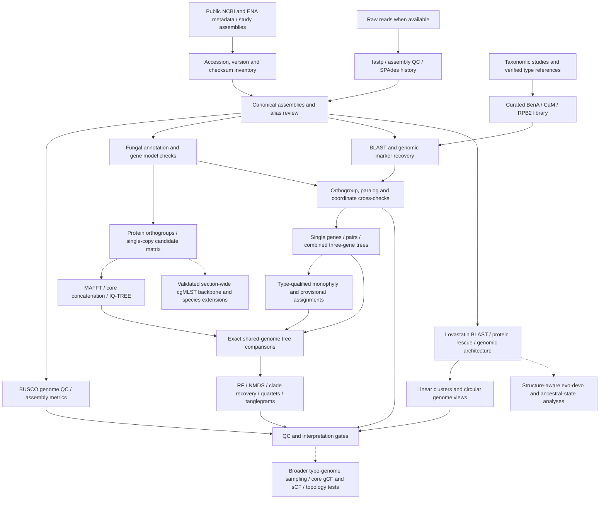
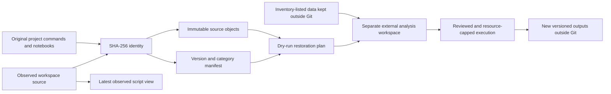

# Workflow, dependencies and outputs

Solid arrows represent implemented paths. Dashed arrows lead to proposals or additional validation. A successful computational run does not automatically close its scientific gate.

## Source and version graph

## What each stage returns

| Stage | Required inputs | Implemented output | Interpretation gate |
|---|---|---|---|
| Provenance | Public records, study labels, file versions | Accession and source manifests | Sequence identity is not culture identity |
| QC | Assembly FASTA; reads when present | Assembly statistics and BUSCO evidence | Read-dependent checks are not applicable without reads |
| Annotation | Genome, repeats, fungal gene models | CDS/protein/transcript models | Multiple isoforms are not automatically separate genes |
| Marker extraction | Curated references and genome sequence | Candidate loci, coordinates and copy evidence | BLAST similarity alone does not establish orthology |
| Phylogeny | Validated aligned loci and partitions | Individual, combined and core trees | Missing loci, supports and reference sampling remain explicit |
| Taxonomy | Verified type reference identities | Type-exclusive sampled clades and name-transfer audit | Do not propagate names across mixed core clades |
| Congruence | Identical leaf identifiers in both trees | RF, NMDS, boundary recovery, quartets and tanglegrams | Core is a comparison baseline, not automatic ground truth |
| BGC | Reference genes and genomic coordinates | Cluster architecture, flanks and circular views | Failed detection differs from biological absence |
| cgMLST | Validated single-copy genomic CDS | Candidate inventories only at present | Alleles, callability and holdout validation are still required |

The individual source files and exact historical variants are linked from the script catalog and version manifest. These graphs describe the implemented workflow and its open extensions; they do not imply a single fully automated orchestrator exists.
